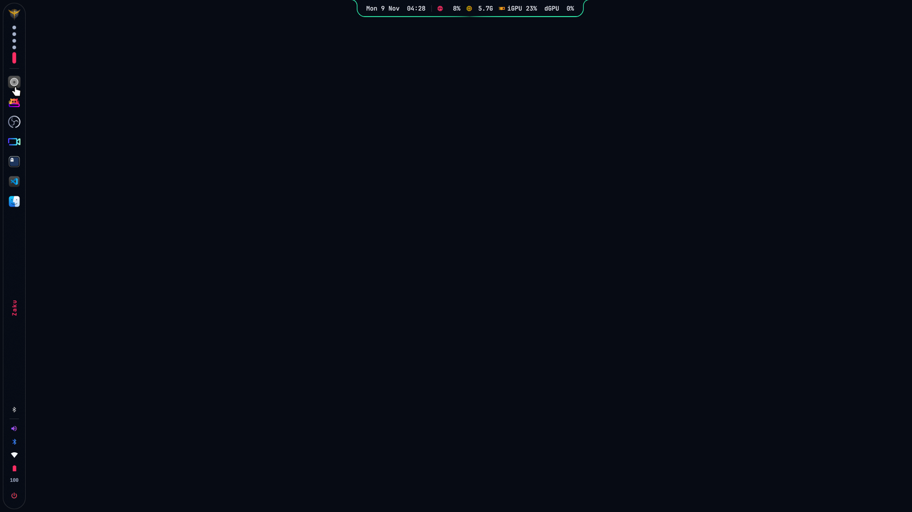
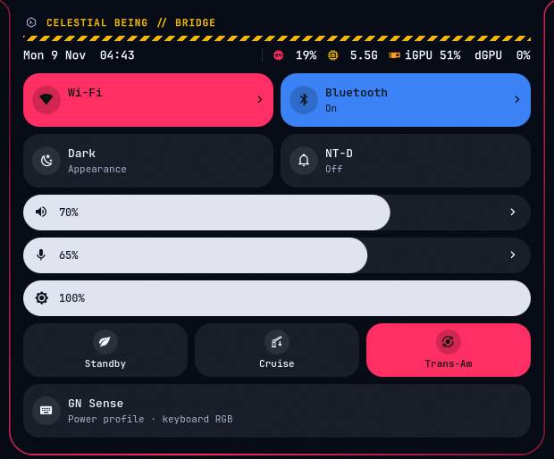
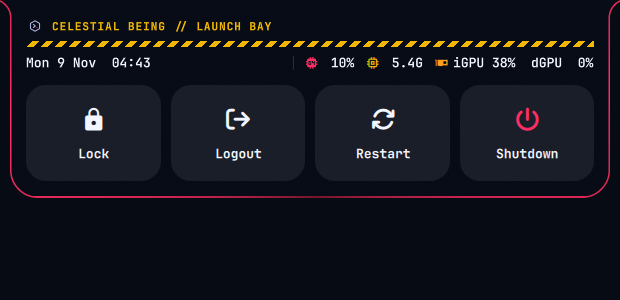
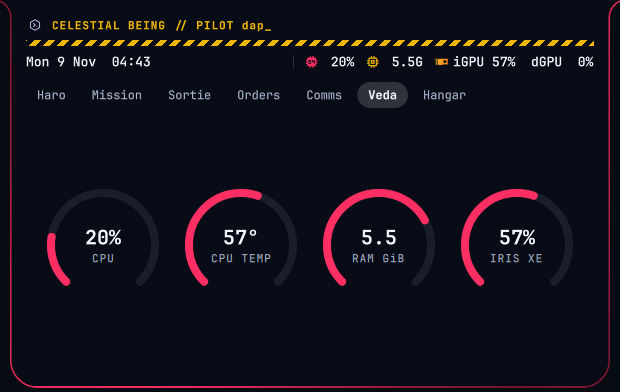
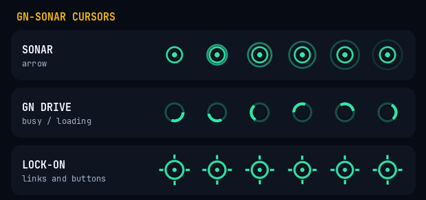
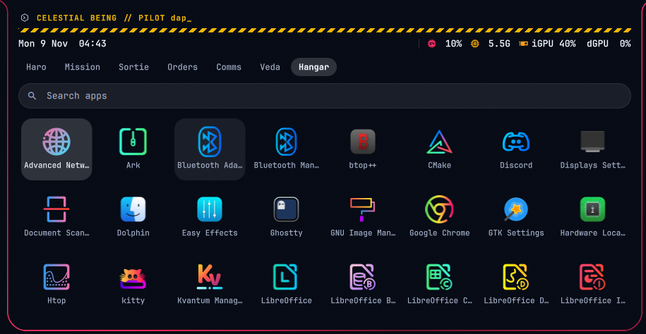

# Celestial Being

A Gundam 00 themed desktop for Arch Linux: Hyprland 0.57 (Lua config) with a Quickshell side bar,
an island that grows out of the top edge into tabs, and a lock screen, plus matching terminal,
prompt and app colors.

Pilot callsigns, GN green, anime blue and Trans-Am red, caution tape. No rainbow.

<p></p>
<p>
  
  
</p>
<p>
  
  
</p>
<p></p>

## Contents

| Path | Installs to |
| --- | --- |
| `hypr/` | `~/.config/hypr/` |
| `quickshell/` | `~/.config/quickshell/` |
| `fish/` | `~/.config/fish/` (includes `conf.d/hud.fish`, the Ghostty-only boot and prompt HUD, and `hud/reveal.py`, its one-second rain and decode boot animation; `NOANIM=1` turns it off) |
| `zsh/.zshrc` | `~/.zshrc` (same aliases as fish, `upgrade`, and the cockpit HUD in Ghostty and kitty) |
| `fastfetch/` | `~/.config/fastfetch/` |
| `kitty/` | `~/.config/kitty/` |
| `ghostty/` | `~/.config/ghostty/` (`thruster.glsl` and `gn-particles.glsl` are off: an animated shader measured about +15% of a core while Ghostty is focused) |
| `starship/starship.toml` | `~/.config/starship.toml` |
| `starship/{full,mid,min}.toml` | `~/.config/starship/`, picked by `hud.fish` from the pane width |
| `waybar/` | `~/.config/waybar/` (fallback bar, not started by default) |
| `kde/kdeglobals` | `~/.config/kdeglobals` |
| `kde/DapGN.colors` | `~/.local/share/color-schemes/DapGN.colors` |
| `qt6ct/` | `~/.config/qt6ct/` |
| `icons/GN-Sonar/` | `~/.local/share/icons/GN-Sonar/` (sonar arrow, GN Drive busy, lock-on pointer; others inherit Bibata-Modern-Ice. Rebuild with `cursor/build-gn-sonar.py`) |
| `hyprfm/` | `~/.config/hyprfm/` (Celestial Being theme for the HyprFM file manager, AUR `hyprfm-git`, optional) |
| `spotify-player/` | `~/.config/spotify-player/` (Celestial Being theme for the `spotify_player` terminal client, optional) |

## Install

On a fresh Arch Linux with a user that can run `sudo`:

```sh
git clone https://github.com/parikesitad-pm/celestial-being.git
cd celestial-being
./install.sh --dry-run   # prints every step, changes nothing
./install.sh
```

The installer:

1. Installs the packages from the Arch repositories, then `yay` (if missing) and the AUR icon and cursor themes.
2. Moves any existing config it replaces to `~/.config-backup/arch-ark-<time>/`, then copies each path in the table above.
3. Fills in the absolute path in `qt6ct.conf` and makes the Hyprland scripts executable.
4. Enables NetworkManager, Bluetooth and power-profiles-daemon.

It does not apply hardware tuning (zram, GPU drivers, NVIDIA). `--skip-packages` copies configs only.

It asks for a **pilot name** (default: your user name) and an optional site or tagline, and puts them where the author's `dap_`, `DAP-01` and `d-ap.my.id` show on screen: bar, island header, terminal HUD, fastfetch, waybar and lock screens. Pass `--pilot NAME --site TEXT` to skip the questions.

Try it without touching your own setup (no sudo, no packages, everything lands in a throwaway home):

```sh
HOME="$(mktemp -d)" ./install.sh --skip-system --pilot tester
```
After it finishes: add the images listed under "Files not included", set your monitors in the `hl.monitor(...)` lines of `hyprland.lua`, run `chsh -s /usr/bin/fish`, and log in to Hyprland.

## Terminal HUD (fish and zsh, Ghostty and kitty)

Each command decodes out of noise before it runs. `sudo`/`doas`/`run0` get a caution stripe and `WARNING // ELEVATED ACCESS`; `git push` gets `GN DRIVE // EXIA LAUNCH`. After it runs: failures glitch red (`FAULT rc=N`), runs over 2 s print `CLEAR`, and runs over 30 s print `TRANS-AM COMPLETE` and send a notification to the island. TUIs (nvim, btop, ssh, …) are skipped; `NOANIM=1` keeps plain lines.

## Layout: side bar and island

- **Side bar** (`SideBar.qml`, left edge): emblem (app menu), desktops, apps (pinned first, then running; right click for pin, new window, close), the desktop name, tray, the Arch logo with status (volume, Bluetooth, LAN, Wi-Fi, battery), and power. The Arch logo opens the Bridge; power opens the Launch Bay.
- **Island** (`Island.qml`, `IslandShape.qml`): hangs from the top edge with concave corners. Closed it shows the date, time, CPU, RAM and GPU; it grows out of the edge into tabs: Haro (music), Mission (calendar), Sortie (focus timer), Orders (todo), Comms (notifications), Veda (system), Hangar (apps). `qs -c dap ipc call shell tab N` opens tab N (0 to 6).
- **Bridge** (`ControlPanel.qml`, a sheet, not a tab): Wi-Fi, Bluetooth, appearance, NT-D, volume, mic, brightness, power profiles, displays, GN Sense. The island grows to fit it. `qs -c dap ipc call shell bridge` (or `cc`) opens it.
- **Veda** (`NotchSystem.qml`): gauges for CPU load, CPU temperature, memory and Iris Xe. The NVIDIA GPU is not read, since reading it wakes the card.
- **Hangar** (`NotchHangar.qml`): every app, with search. The island opens extra wide on this tab. Type to filter, Enter launches the highlighted app, arrows move.
- **Launch Bay** (`PowerSheet.qml`, a sheet): Lock runs at once; Logout, Restart and Shutdown need a second, explicit confirm under caution tape. `qs -c dap ipc call shell power` opens it.
- **Cursors (GN-Sonar):** the arrow is a GN green dot and ring that sends a sonar ping every 1.2 s; busy and loading spin a GN Drive arc; links and buttons show a lock-on reticle. Text, resize and move cursors come from Bibata.
- **Wallpaper profiles:** `hypr/wallpaper-profiles` lists `name file dark|light` per line. The Bridge's Dark tile toggles dark/light; its arrow cycles profiles (`theme.sh next`).
- **Colors:** the side bar and the closed island share a still GN green ring; window borders and the open island are anime blue, or red in Trans-Am (performance profile). NT-D (Do Not Disturb) turns the ring psycho-frame red. The Wi-Fi and Bluetooth pages sweep a Zaku mono-eye while they load. On battery, a critical "GN particles low" alarm fires at 15% and 5%.
- **GN Sense** (optional, [gn-sense](https://github.com/parikesitad-pm/gn-sense)): power profile and keyboard RGB for Acer Nitro and Predator laptops, shown as an island sheet. The island loads gn-sense's `SenseCard.qml` when gn-sense is installed; the keyboard's N key (keycode 433), the Bridge tile and `qs -c dap ipc call shell sense` open it. Without gn-sense the tile is disabled.
- **Notifications:** the shell is the notification server (`NotificationServer` in `Ui.qml`); swaync is not started. `Super+N` opens the Comms tab. Action buttons are passed back to the sending app.
- **Calendar and alarms** (`Agenda.qml`, `Ics.js`): alarms are saved in `~/.local/state/dap-shell-alarms.json`. To show Google Calendar events, paste the calendar's "Secret address in iCal format" into `~/.config/dap-shell/gcal-ics-url` (mode 600). That address gives read access to the calendar, so keep it out of the repo.

## Displays and desktops

Four desktops always exist: Exia, Dynames, Kyrios and Virtue. **New desktop** in the Overview adds Freedom, Zaku, Unicorn, 00 Raiser, RX-78-2, Strike, Wing and Barbatos, in that order; an empty added desktop shows a close button on hover. Added desktops are gone after a restart. Control Center > Arrange displays places the external monitor left or right of the laptop. The side is saved to `~/.local/state/dap-display-side`. Set your own monitors in the `hl.monitor(...)` lines of `hyprland.lua`.

## Search, apps and Quick Look

- **Search:** `Super+Space` opens the island as one search line; results appear below as you type. Enter launches, Up/Down move, Esc closes (`SearchSheet.qml`).
- **Hangar:** the side bar's emblem opens the wide app grid in the island.
- **Screenshots:** ⌘⇧3 screen, ⌘⇧4 selection, ⌘⇧W window, ⌘⇧5 toolbar, ⌘⇧6 record. The selection picker (`RegionSelect.qml`) dims the rest of the screen, runs guide lines from the selection's edges, and has corner handles: drag to select, drag inside to move, drag a corner to resize, Enter or double-click to capture, Esc to cancel. GN green for screenshots, Trans-Am red for recording. Files go to `~/Pictures/Screenshots` and the clipboard.
- **Quick Look:** `Alt+Space` in Dolphin runs `hypr/scripts/preview.sh`. Images and text open in `Preview.qml`; other file types open in their default app. Other apps still receive the key.

Dolphin has no D-Bus call for the selection, so `preview.sh` triggers its Copy Location action, then restores the clipboard and removes the path from the cliphist history. Only one clipboard format is restored, so formatted text can paste as plain text.

## Dolphin theme

Dolphin needs all three of these to render dark with readable file names:

- `qt6ct/` sets the palette used for file names. `QT_QPA_PLATFORMTHEME=qt6ct` is set in `hyprland.lua`.
- `kde/kdeglobals` holds the color groups and `[UiSettings] ColorScheme=DapGN`.
- `kde/DapGN.colors` is the scheme that key points to.

These settings also change Ark and any other app that follows `qt6ct` or KDE color schemes. VLC does not follow them.

## Files not included

Images are left out for copyright and privacy. Add your own or the matching image will be blank:

- `~/Pictures/wallpapers/gundam-dark.jpg` (wallpaper, path in `hypr/hyprpaper.conf`)
- `~/.config/quickshell/dap-lock/assets/avatar.jpg`
- `~/.config/quickshell/dap-lock/assets/gundam-lock.png`
- `~/.local/share/dap-shell/cb-32.png`, `cb-64.png`, `cb-128.png`

## Related

- [gn-sense](https://github.com/parikesitad-pm/gn-sense): power profile and keyboard RGB panel for
  Acer Nitro and Predator laptops, in the same theme.

## Status

Exported from the author's daily setup on an Acer Nitro AN515-56. The installer has been run with
`--dry-run` and in a throwaway home, not yet on a clean install. Reports are welcome.

## License

MIT, copyright Dausan Adam Parikesit (dap_). See [LICENSE](LICENSE). Gundam and Celestial Being are
trademarks of Sunrise/Bandai Namco; this is an unofficial fan theme. Screenshots use a plain
background; the wallpapers are not included.
